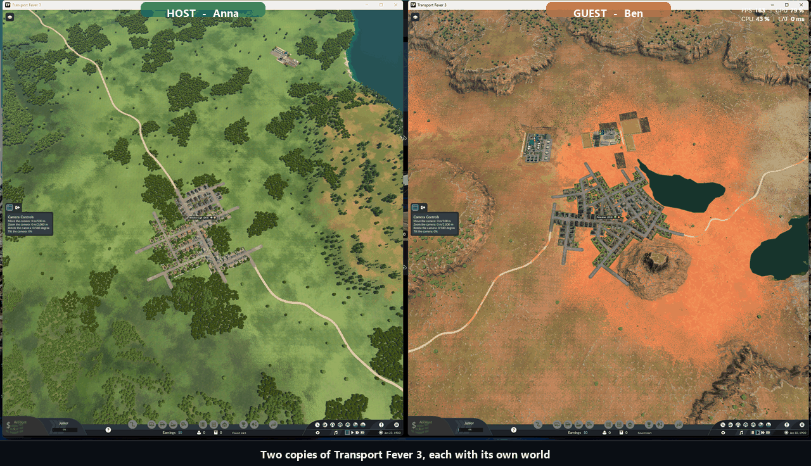

# FeverLink3

Cooperative multiplayer for Transport Fever 3. The goal: several players build in one world at the same time, each in their own copy of the game. Source available under the PolyForm Noncommercial License (free for noncommercial use; see Licence below), Windows and Steam only, unofficial.

**Status: early test build (0.2.0-test5), last updated 2026-10-10. Two players can host, join and see each other's speed, pause and chat commands in two real games; building has been seen working for a thin slice (roads, bulldozing, lines); stations, rail, vehicles and terrain have not been tried.** What is real and what is not:

- **Verified in the real game** (build 40420): the mod loads; its window opens from a button in the bottom bar; the Steam peer-to-peer connection works between two different accounts (a friend's test: connected, 199 ms round trip through a Steam relay); and with two real copies of the game on one PC, using the developer connection on the loopback address, a host can host a game, copy the join code, a guest can paste it and join, the host's world is sent and the guest's game loads it while the host keeps playing, and speed, pause and chat from either side show up in both games. See the demo: [docs/media/split-screen-demo.gif](docs/media/split-screen-demo.gif).
- **Not verified yet:** hosting and joining over Steam between two accounts (the code is there, the test with a friend is pending), stations, depots, rail, buying vehicles and terrain between two real games, long sessions in a busy world with vehicles (the host-keeps-playing sync was checked on a small world with no lines), and the native command hooks (switched off unless a developer turns them on; the capture-and-hold hook has been run in two real games for roads and the bulldozer, the rest has not).

Details and dates: [docs/ROADMAP.md](docs/ROADMAP.md). How to try the test build: [docs/PLAYING.md](docs/PLAYING.md). What the `winhttp.dll` file is and why antivirus programs may look at it: [docs/SECURITY_FOR_USERS.md](docs/SECURITY_FOR_USERS.md).

## See it working

Two real copies of the game side by side, each starting in its own world. The left one hosts, the right one joins with the copied code, the host's world is sent to the guest, then each side gives commands and the other game follows. (Recorded with `tools/gametest/demo_split.ps1`; the names are made up.)



## How it works

Transport Fever 3 has no network code, so FeverLink3 keeps every copy of the world identical instead of sending the world around:

1. **Commands, not state.** Every player action is captured as the engine command it produces, stamped with a future simulation step, and sent to everyone. Every game, including the one where the player clicked, applies it at that step. Identical inputs on a deterministic simulation give identical worlds.
2. **Host authority.** One game is the authority. The games compare world checksums at common steps; a lasting difference is repaired by loading the host's savegame in the other games (the host keeps playing; a switch makes the host's game reload too).
3. **Sealed transport.** A join code carries the session secret. Everything on the wire is encrypted and authenticated with a key derived from it; the host decides who speaks and what kinds of messages a player may send.
4. **No entity ids on the wire.** Entity ids differ between games, so roads travel as positions, constructions as file plus placement, vehicles and lines as per-session keys.
5. **Connecting the players.** The players' games reach each other through Steam's peer-to-peer networking, so a player only has to share a join code and has nothing to set up. The Steam connection has been proven between two different accounts in the connection test; carrying whole sessions over it is the next test.

The design is written up in [docs/ARCHITECTURE.md](docs/ARCHITECTURE.md). FeverLink3 is for Transport Fever 3 only; it does not support Transport Fever 2.

## Try the test build

Short version (the full guide is [docs/PLAYING.md](docs/PLAYING.md)):

1. Unzip the release, close the game, and copy `winhttp.dll` and the `mods` folder from the zip into the game's folder (in Steam: right-click Transport Fever 3, Manage, Browse local files). There is no installer.
2. Start Transport Fever 3 from Steam and activate the mod *FeverLink3 Multiplayer* when starting a game.
3. Click **FeverLink3** in the bar at the bottom of the screen. The host clicks **Host a game**, presses **Copy code** and sends the code; a friend pastes it (Ctrl+V) and presses **Join**, and the host presses **Start the session**.
4. For connection problems, the window has a **Connection test...** section (two players exchange Steam IDs).
5. To measure how fast a save can cross Steam (an 80 MB save is the size that matters), the same section has a **speed test**: pick 8, 32 or 80 MB and press **Run the speed test**; the steps for two players are in [docs/PLAYING.md](docs/PLAYING.md) section 5, the design in [docs/STEAM_TRANSPORT.md](docs/STEAM_TRANSPORT.md) section 7.1. `FEVERLINK3_STEAM_SENDRATE=<bytes per second>` changes Steam's send rate for such a test.

To remove everything: delete `winhttp.dll` and `mods
eleaseeverlink3_1` from the game's folder. The `feverlink3.exe` helper in this repository is a developer tool and is not in the zip: the plan is that the mod reaches players from the in-game Mod Hub or Nexus Mods, with the native module (`winhttp.dll`) delivered separately for now ([docs/WORKSHOP.md](docs/WORKSHOP.md)).

## Credits

FeverLink3 is a fresh implementation, not a fork, but it stands on two projects that proved the model and documented their findings. Both are MIT-licensed, and their licences are reproduced in [THIRD_PARTY_NOTICES.md](THIRD_PARTY_NOTICES.md).

- **[TpF2 Multiplayer](https://github.com/silver2127/tpf2-multiplayer)** by silver2127, for Transport Fever 2 (project page: https://silver2127.github.io/tpf2-multiplayer/). Source of the three replication modes, the "no entity ids on the wire" rule, the join-code and sealed-transport trust model, and the host-included resync round. Its `docs/` folder is the best written account of lockstep on this engine.
- **[MPFever](https://github.com/dkdknight/MPFever)** by dkdknight (arthur), for Transport Fever 3. First to run lockstep co-op on TF3: the proxy-DLL hold-and-release of construction commands, the single-worker script pool fix for determinism, deterministic `math.random`, and native terrain-cell copying. When FeverLink3 reuses a specific finding or table from it, the file says so.

If you are the author of either and want the wording changed, open an issue.

FeverLink3 is not affiliated with, endorsed by or supported by Urban Games or Paradox Interactive. Transport Fever is a trademark of its owners; the name is used here only to say which game the mod is for.

## Layout

| Folder | Role | Language |
|---|---|---|
| `core/` | Crate `feverlink3_core`. Protocol: framing, sealed channel, join codes, the host and player session state machines, resync and permissions. No game or UI code. Tests in `core/tests`. | Rust |
| `launcher/` | Crate `feverlink3_launcher` and the `feverlink3` command (`install`, `uninstall`, `doctor`, `selftest`, and `host` / `join` for development). Also the session controller that runs inside the game, the file link to the mod, savegame transfer and update verification. See `launcher/README.md`. | Rust |
| `native/` | `winhttp.dll`: the proxy the game loads itself. It relays the 14 WinHTTP functions the game imports and starts the in-game session controller. It also contains the command counters, the capture-and-hold hook, the determinism patch and the control link to the mod; all of that is off unless switched on by environment variables, is tested on fake game functions, and has been run in two real games only for the road and bulldozer hold; the rest has not run in the game. See `native/README.md` and `docs/NATIVE_LINK.md`. | Rust |
| `mod/feverlink3_1/` | Game-script mod: lockstep core (stamping, barrier, pause, queue, deterministic random, checksums), file link, command capture and the command schemas for everyday operations, and the in-game window. See `mod/README.md`. | Lua |
| `tools/addr/` | Address tool: finds the hook sites in a game executable and prints a build-table row. See `tools/addr/README.md`. | Python |
| `tools/release/` | Release tool: reproducible zip, manifest with SHA-256, Ed25519 key generation and signing. See `docs/RELEASING.md`. | Rust |
| `tests/lua/` | Two mocked games running the real mod through lupa (lockstep core, and the operations schemas). `core/tests/` and the native crate run under `cargo test --workspace`. | Python, Rust |
| `docs/` | Architecture, roadmap, protocol, playing guide, security review (`SECURITY.md`) and explainer, release and listing notes, command coverage and research notes. | |

The repository is one Cargo workspace (`core`, `native`, `launcher`, `tools/release`).

## Building

Requires [stable Rust](https://rustup.rs). No other SDK.

```
cargo test --workspace
cargo build --release -p feverlink3_native      # target/release/feverlink3_native.dll -> ship as winhttp.dll
cargo build --release -p feverlink3_launcher    # target/release/feverlink3.exe
pip install lupa && python -I tests/lua/test_lockstep.py && python -I tests/lua/test_cmds_ops.py
```

Releases are built by GitHub Actions from a tag, never on a developer's PC; see [docs/RELEASING.md](docs/RELEASING.md).

## Contributing

Issues and pull requests are welcome. Read `docs/ARCHITECTURE.md` first; design changes go through an issue before code. Every change to `core/` needs a test.

## Contact

Discord: `azalshehri`. Bug reports and feature requests go to [GitHub issues](https://github.com/AZalshehri7/FeverLink3/issues); for anything else, or to join the first test sessions, message me on Discord.

## Licence

FeverLink3 is licensed under the [PolyForm Noncommercial License 1.0.0](LICENSE): you may use, study, modify and share it for any noncommercial purpose, keeping the copyright notice. **Commercial use needs a separate commercial license**; contact me on Discord (`azalshehri`). The few parts adapted from TpF2 Multiplayer and MPFever stay under their own MIT licences, reproduced in [THIRD_PARTY_NOTICES.md](THIRD_PARTY_NOTICES.md).
