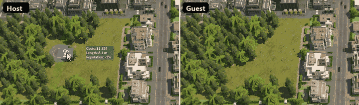
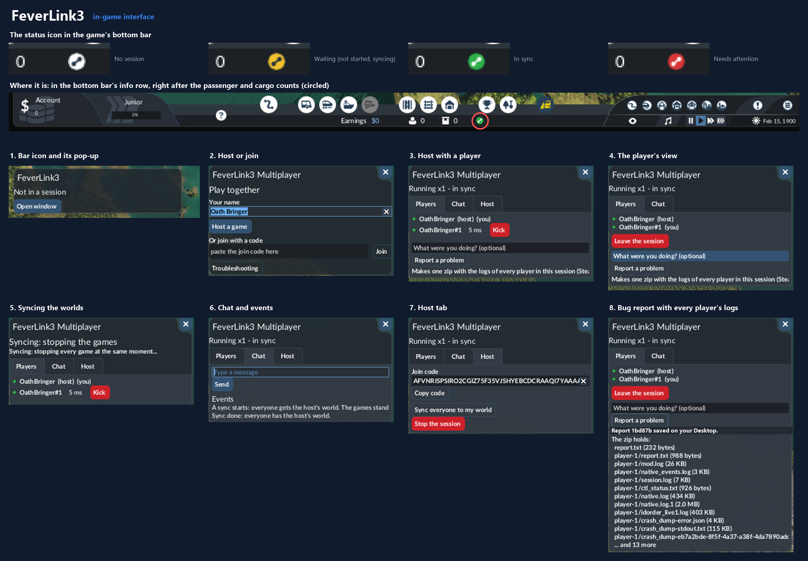

# FeverLink3

**Play Transport Fever 3 together. Several players build in one shared world, each in their own game.**

Version 0.2.1 · Windows and Steam · source available (PolyForm Noncommercial) · unofficial · Last updated 2026-10-22

FeverLink3 is in beta: keep backups of the saves you play with.

[Quick start](#quick-start) · [Download](#download) · [Playing guide](PLAYING.html) · [FAQ](site/faq.html) · [Status](site/status.html) · [Changelog](CHANGELOG.html) · [Source on GitHub](https://github.com/AZalshehri7/FeverLink3)

*Real time: the road stands on both games 1.4 s after the click at game speed x1 (normal) and 0.8 s at x4 (two games on one PC, a grown save with 6,393 inhabitants). The wait is a safety margin: every game builds at the same game step. In the beta, stability comes first.*

## What you get

- **Built into the game.** No separate launcher or program to run: start Transport Fever 3 from Steam as usual. Host, join, chat, sync and updates all live in the game's bottom bar and window.
- **Build together.** Roads, rail, stations, stops, depots, lines and vehicles: what one player builds appears in every game.
- **The full game.** Towns grow, traffic flows, ratings change, exactly as in single player. Nothing is switched off.
- **Easy to join.** Over Steam: no ports, no router settings, no IP addresses. The host sends a join code, the friend pastes it.
- **Steam invites.** Invite friends from Steam's own invite dialog; with a world loaded they join by themselves (new in 0.2.1, not yet tried on two PCs).
- **Always the same world.** The games check each other all the time. If they ever drift apart, everyone gets the host's world back in a few seconds and play goes on.
- **Shared speed, pause and chat.**
- **Encrypted.** Everything between the games is encrypted; the join code works like a password.
- **One-click bug reports.** "Report a problem" collects the logs of every player in the session into one zip, with personal data removed.
- **Updates by itself.** New versions arrive automatically from the official GitHub releases.

## The interface

A coloured icon in the game's bottom bar shows the session at a glance: white (no session), yellow (waiting), green (in sync), red (needs attention). Click it for the details.

## Quick start

1. Download `FeverLink3-0.2.1.zip` from [Releases](https://github.com/AZalshehri7/FeverLink3/releases/latest) and extract it.
2. Close the game. In Steam, right-click **Transport Fever 3** → **Manage** → **Browse local files**.
3. Copy `winhttp.dll` and the `mods` folder into that folder (merge the folders when Windows asks).
4. Start the game from Steam, and turn on **FeverLink3 Multiplayer** in the mod list when you start or load a game.
5. **Host:** click the FeverLink3 icon in the bottom bar → **Host a game** → **Copy code** and send it to your friend → **Start the session** when they appear. **Join:** open the FeverLink3 window, paste the code (`Ctrl+V`) and press **Join**. Only join people you trust.

Every player installs FeverLink3 and needs the same game version. After this first install, updates arrive automatically. More in the [playing guide](PLAYING.html).

**Uninstall:** close the game and delete `winhttp.dll` and the folder `mods\release\feverlink3` from the game's folder.

## Download

The newest version is always at [github.com/AZalshehri7/FeverLink3/releases/latest](https://github.com/AZalshehri7/FeverLink3/releases/latest). Each release has one zip, its `.sha256` file and a `manifest.json`, so you can check what you downloaded: see [Security for players](SECURITY_FOR_USERS.html). The files are not code-signed yet (planned for 1.0.0), so Windows or your antivirus may warn about the new file.

## More

- [Playing guide](PLAYING.html): install, host, join, and what to do when something goes wrong
- [FAQ](site/faq.html)
- [Status](site/status.html): what has been seen working in the real game, and what not yet
- [Changelog](CHANGELOG.html)
- [Roadmap](ROADMAP.html)
- [Privacy](site/privacy.html)
- [Security for players](SECURITY_FOR_USERS.html): what is in `winhttp.dll` and how to check it
- [How builds sync](site/how-builds-sync.html)

## Credits

FeverLink3 builds on what earlier Transport Fever multiplayer projects found and documented; their licences are in [THIRD_PARTY_NOTICES.md](https://github.com/AZalshehri7/FeverLink3/blob/main/THIRD_PARTY_NOTICES.md). It uses the game's official scripting API as described in the [Transport Fever 3 modding wiki](https://wiki.transportfever3.com/doku.php?id=modding) and the [TF3 docs](https://tf3-docs.transportfever.net/en/guides/index.html).

## Contact

Bugs and requests: [GitHub issues](https://github.com/AZalshehri7/FeverLink3/issues) (use **Report a problem** in the game to make the zip). Discord: `azalshehri`.

## Licence

[PolyForm Noncommercial 1.0.0](https://github.com/AZalshehri7/FeverLink3/blob/main/LICENSE): free to use, study, change and share for noncommercial purposes. For commercial use, ask on Discord.

FeverLink3 is an unofficial fan project for Transport Fever 3 (Windows, Steam). It is not affiliated with or endorsed by Urban Games or Paradox Interactive.
